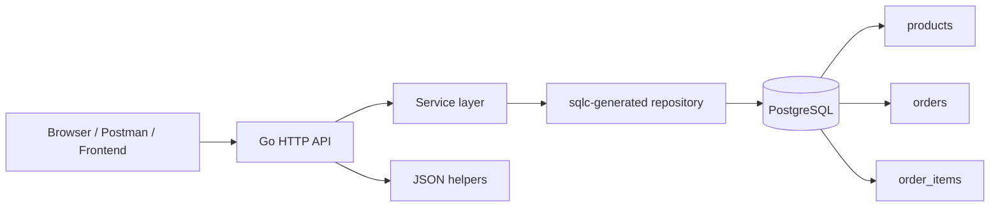
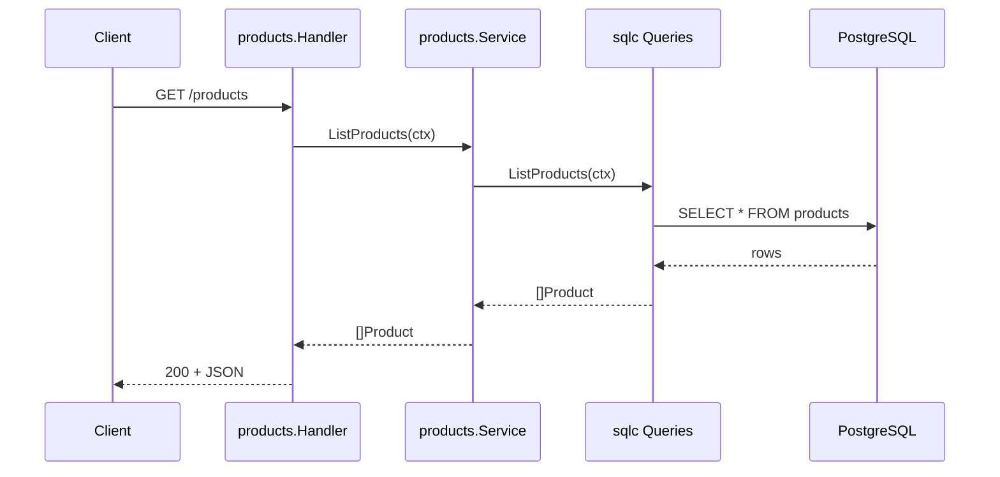
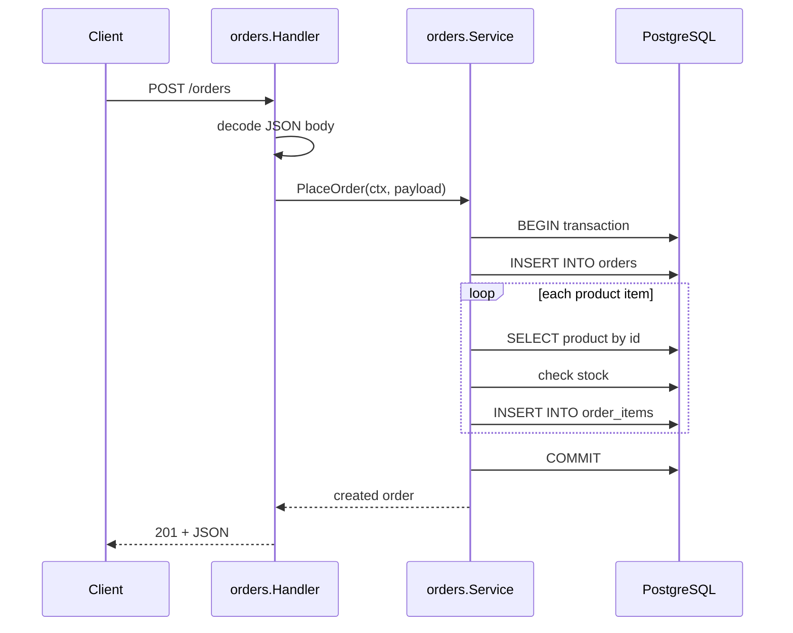
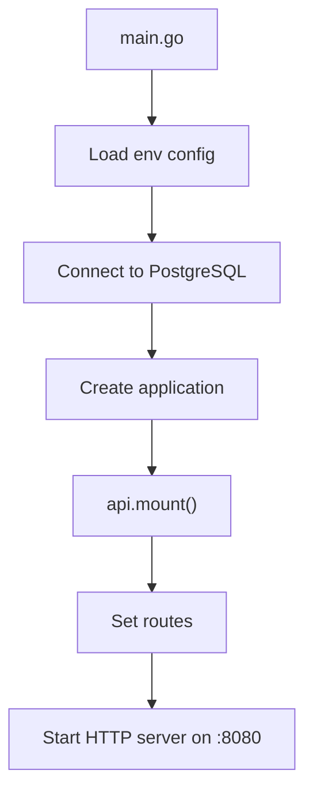
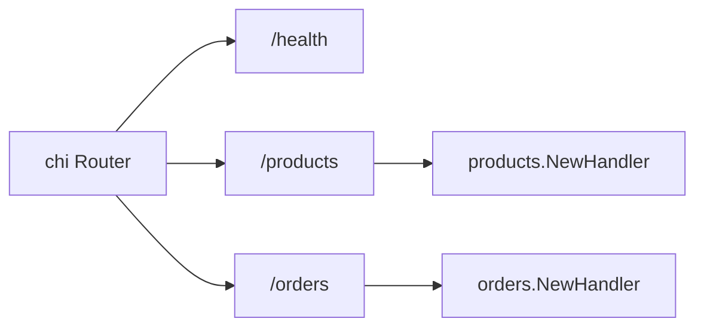
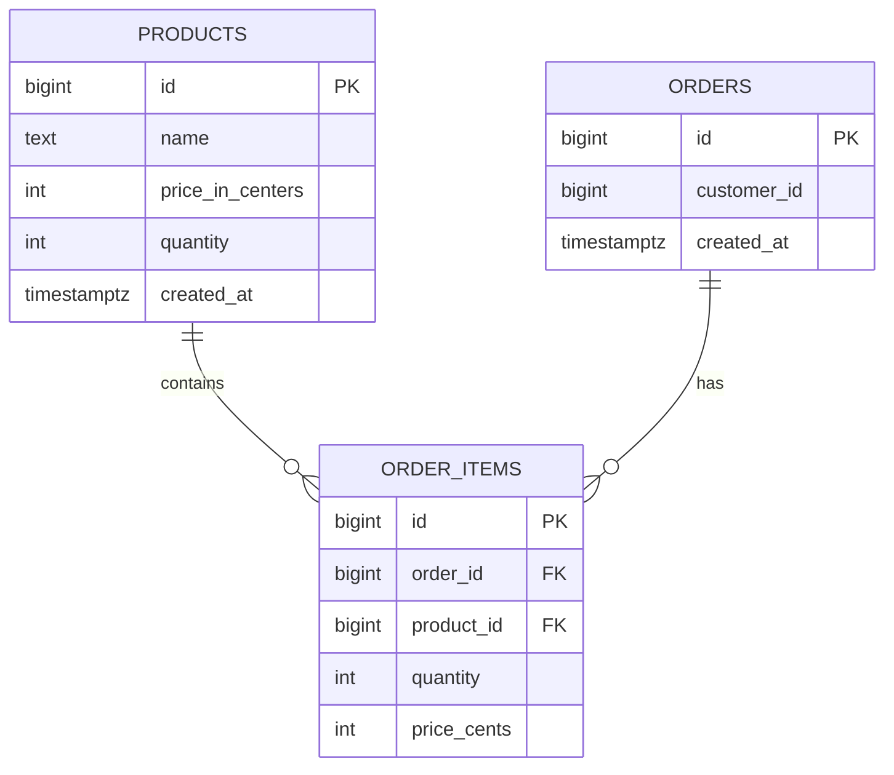
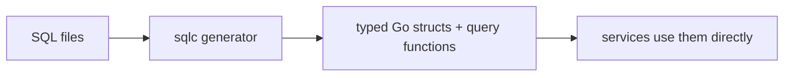
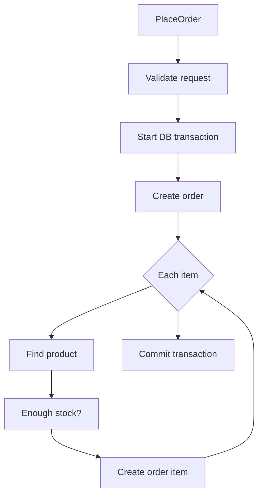
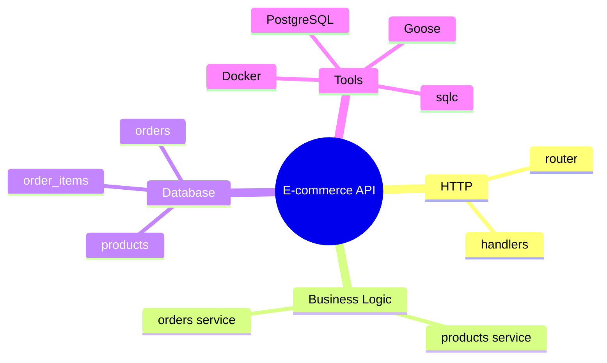

# E-commerce API – Beginner Guide

This project is a small backend API for an e-commerce app. It exposes a few HTTP endpoints to:

- list products
- create an order
- save order items
- talk to PostgreSQL through generated database code

The main idea is simple: the API receives HTTP requests, validates them, asks the database for data, and returns JSON.

---

## 1) Big picture



Think of it like this:

- Client sends request
- API router decides which endpoint to call
- Service contains business rules
- Repository talks to database
- Database stores products and orders

---

## 2) The app in one sentence

This is a Go service with:

- `chi` for HTTP routing
- PostgreSQL for storage
- `sqlc` for typed SQL access
- `goose` for database migrations
- Docker Compose for local database setup

---

## 3) Request flow

### Get all products



### Create an order



---

## 4) Main folder map

```text
.
├── cmd/
│   ├── main.go          # app startup
│   └── api.go           # router + HTTP server setup
├── internal/
│   ├── adapters/
│   │   └── postgresql/
│   │       ├── migrations/   # SQL schema history
│   │       └── sqlc/         # generated Go database code
│   ├── env/
│   │   └── env.go            # reads env vars
│   ├── json/
│   │   └── json.go           # JSON read/write helpers
│   ├── orders/
│   │   ├── handlers.go       # HTTP endpoint logic
│   │   ├── service.go         # order business rules
│   │   └── types.go          # request/response types
│   └── products/
│       ├── handlers.go       # HTTP endpoint logic
│       └── service.go         # product listing logic
├── docker-compose.yaml       # local PostgreSQL container
├── sqlc.yaml                 # sqlc config
├── go.mod                    # Go dependencies
├── README.md                 # short project instructions
└── PROJECT_EXPLAINED.md      # this guide
```

---

## 5) Startup flow



### What happens in `cmd/main.go`

- creates a background context
- builds config
- connects to PostgreSQL using `pgx`
- creates `application`
- calls `api.mount()`
- starts the HTTP server

This is the app's entry point.

---

## 6) Route setup

The router is defined in `cmd/api.go`.



### Routes in this project

| Route | Method | Purpose |
|---|---|---|
| `/health` | GET | simple health check |
| `/products` | GET | list products |
| `/orders` | POST | create order |

---

## 7) The database design



### `products`
Stores products with:

- `id`
- `name`
- `price_in_centers`
- `quantity`
- `created_at`

### `orders`
Stores a customer order header:

- `id`
- `customer_id`
- `created_at`

### `order_items`
Stores each product inside an order:

- product id
- quantity
- price at time of order

This is important because order prices should not change later if the product price changes.

---

## 8) SQLC: why this project uses it

The SQL queries live in `internal/adapters/postgresql/sqlc/queries.sql`.

```sql
-- name: ListProducts :many
SELECT * FROM products;
```

Then `sqlc` generates Go code automatically.



This is useful because:

- you write SQL once
- Go gets strongly typed structs
- less manual database boilerplate

---

## 9) Service layer: business logic

The project separates logic into services.

### Products service

File: `internal/products/service.go`

- has a `ListProducts` method
- calls `repo.ListProducts(ctx)`
- returns list of products

### Orders service

File: `internal/orders/service.go`

This is where the real business rules live:

- check `customerId` is present
- check at least one item exists
- begin a DB transaction
- create a new order row
- for each item:
  - find product by ID
  - check stock
  - create order item
- commit transaction



Important note:

- the code already checks stock before creating items
- the “update product stock quantity” step is still a challenge / TODO in the code, which means this project is intentionally demonstrating a real-world workflow without finishing every edge case

---

## 10) HTTP layer and JSON helpers

The project uses a small helper package:

- `internal/json/json.go`

It provides:

- `Write(...)` to send JSON responses
- `Read(...)` to decode request body JSON

This keeps handlers clean and consistent.

Example idea:

```go
json.Write(w, http.StatusCreated, createdOrder)
```

This writes:

- `Content-Type: application/json`
- correct status code
- JSON body

---

## 11) Why this structure is useful

This project uses a classic backend layout:

- `cmd` = startup and wiring
- `internal` = project internals
- `handlers` = HTTP entry points
- `service` = business logic
- `sqlc` = database access
- `migrations` = schema history

This is a clean pattern for bigger apps because it keeps things separated.

---

## 12) Simple mental model



At a very high level:

- HTTP gets requests
- services decide what to do
- SQL talks to the database
- PostgreSQL stores the data

---

## 13) How to run it

### Start PostgreSQL

```bash
docker compose up -d
```

### Run the API

```bash
go run cmd/*.go
```

Then open these endpoints:

- `http://localhost:8080/health`
- `http://localhost:8080/products`
- `http://localhost:8080/orders`

---

## 14) Beginner cheat sheet

### Request from client

- goes to router
- matched to a handler
- handler calls service
- service calls SQL-generated repo
- repo sends SQL to PostgreSQL

### Data flow

```text
JSON request
   ↓
handler
   ↓
service
   ↓
sqlc-generated query
   ↓
PostgreSQL
   ↓
Go structs
   ↓
JSON response
```
